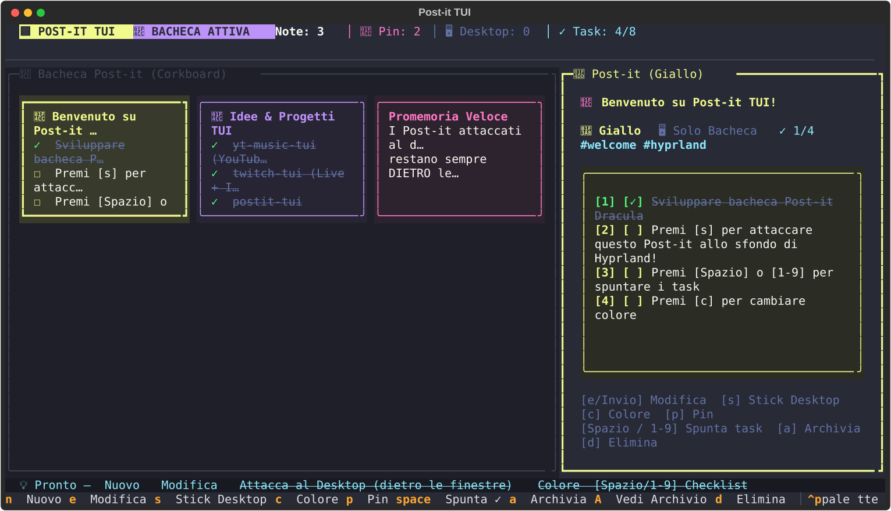
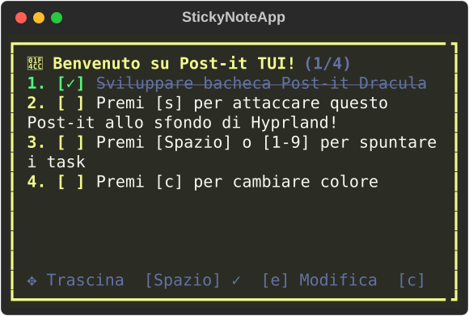

<div align="center">

# 📌 postit-tui

**Dracula-themed Corkboard Post-it Note Manager & Hyprland Bottom-Layer Desktop Sticky Notes**

[](https://www.python.org)
[](https://textual.textualize.io)
[](https://hyprland.org)
[](https://draculatheme.com)
[](LICENSE)

<br/>



</div>

---

## ✨ Features

- 📌 **2D Corkboard Grid Layout**: Visual kanban/corkboard grid of colored Post-it cards with live checklist progress (`[✓]`), `#tags`, and pin/desktop badges.
- 🖥️ **Desktop Sticky Notes Behind All Windows (`wlr-layer-shell` bottom layer)**:
  - Press **`s`** on any Post-it to stick it directly onto your **Hyprland / Wayland desktop wallpaper**.
  - Runs on Wayland's **`bottom` layer** via `kitty +kitten panel --layer=bottom`: your Post-it notes sit **above the wallpaper and behind all tiled/floating windows**, so they never cover your active work.
  - **Real-time Mouse Dragging**: Click and drag any desktop Post-it with your mouse — moves smoothly in real time via Kitty's zero-overhead UNIX socket remote control (`resize-os-window os-panel`).
- 🎨 **6 Dracula Post-it Colors**: Cycle instantly with **`c`** between **Giallo** (`#f1fa8c`), **Rosa** (`#ff79c6`), **Viola** (`#bd93f9`), **Verde** (`#50fa7b`), **Azzurro** (`#8be9fd`), and **Arancione** (`#ffb86c`).
- ☑️ **Interactive Checklists**: Create `- [ ]` tasks and toggle them directly from the Corkboard or Desktop Sticky Note using **`Space`**, number keys **`1`–`9`**, or a mouse click.
- 📂 **Plain Markdown + Frontmatter Storage**: Every Post-it is saved as a human-readable `.md` file in `~/.local/share/postit-tui/notes/`, compatible with Obsidian, Neovim, and Git.
- 📊 **Waybar & Fuzzel Integration**: Dedicated Waybar pill (`󰠮`) with live note/checklist counters and tooltip summary + desktop entry for `SUPER+D`.

<div align="center">

</div>

---

## ⌨️ Keybindings

### Corkboard TUI (`postit-tui`)

| Key | Action |
| :--- | :--- |
| `h` / `j` / `k` / `l` or `←` `↓` `↑` `→` | Navigate 2D Corkboard Grid |
| `n` | Create a new Post-it note |
| `e` / `Enter` | Edit selected Post-it (Title, Tags, Markdown & Checklists) |
| `Ctrl+S` / `Esc` | Save changes & close editor |
| `s` | **Stick / Unstick** Post-it on Desktop Wallpaper (behind all windows) |
| `c` | Cycle Dracula Post-it color (Yellow, Pink, Purple, Green, Cyan, Orange) |
| `p` | Pin / Unpin Post-it to top of board |
| `Space` or `1`–`9` | Toggle checklist item (`[ ]` ↔ `[x]`) |
| `a` / `A` | Archive / Unarchive note (`a`), Toggle Archive view (`A`) |
| `d` | Delete selected Post-it |
| `/` | Instant search by text or `#tag` |
| `t` | Cycle filter by `#tag` |
| `q` | Quit |

### Desktop Sticky Note (`layer=bottom`)

| Interaction | Action |
| :--- | :--- |
| **Mouse Left Drag** | Drag Post-it anywhere on the desktop wallpaper |
| **Mouse Left Click** / `Space` / `1`–`5` | Toggle checklist item |
| `h` / `j` / `k` / `l` or Arrows | Nudge desktop position |
| `+` / `-` | Resize desktop sticky note |
| `c` | Cycle Dracula Post-it color |
| `e` | Edit note inline on the desktop |
| `s` / `q` | Unstick from desktop |

---

## 🚀 CLI Usage

```bash
# Launch the Corkboard TUI
postit-tui

# Quickly create a Post-it from terminal (and optionally stick it to the desktop)
postit-tui add "Release v1.0" -b "- [ ] Tag repo\n- [ ] Push package" -c purple --pin --desktop

# List all saved Post-it notes in terminal
postit-tui list

# Restore all desktop sticky notes on Hyprland startup
postit-tui daemon

# Toggle showing/hiding all desktop sticky notes
postit-tui toggle-desktop

# Output JSON status for Waybar
postit-tui waybar
```

---

## 📄 License

MIT License — see [LICENSE](LICENSE).
